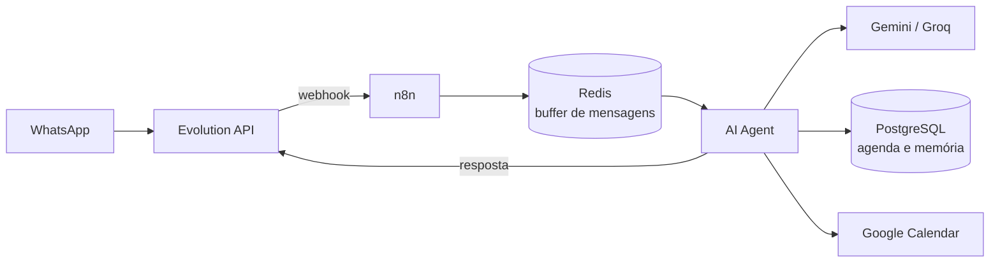

# agente-agendamento-whatsap
# Agente de Agendamento para Clínicas e Salões (WhatsApp + IA)

Agente de IA que atende clientes pelo WhatsApp e agenda, consulta e cancela horários sozinho, evitando conflitos e sincronizando com o Google Calendar. Roda 100% self-hosted (n8n, Evolution API, Redis e PostgreSQL em uma VPS), usando apenas camadas gratuitas de IA.

> Projeto de portfólio. Demonstra orquestração de agentes com ferramentas (tool calling), tratamento de mensagens em sequência, persistência em banco e integração com serviços externos.

## O problema

Clínicas e salões perdem tempo e dinheiro com agenda manual: a recepção responde as mesmas mensagens o dia todo, horários são marcados em duplicidade e o cliente que não recebe resposta rápida desiste. Este projeto automatiza o primeiro atendimento e o controle da agenda.

## O que funciona hoje

- Conversa natural em português pelo WhatsApp ("quero cortar o cabelo com o Carlos amanhã às 10h").
- **Agendar, consultar e cancelar** horários, por profissional.
- **Verificação de conflito** antes de criar, com sugestão de outro horário.
- **Cadastro automático** do cliente (telefone e nome).
- **Sincronização com o Google Calendar**: cada agendamento vira um evento, e o cancelamento apaga o evento.
- **Buffer de mensagens**: se o cliente manda várias mensagens seguidas, o agente espera uma pausa e responde a todas de uma vez.
- **Memória de conversa** por cliente (PostgreSQL).

## Arquitetura



Fluxo de uma mensagem:

1. A Evolution API envia o evento ao webhook do n8n, que ignora tudo que não for mensagem recebida.
2. A mensagem entra no buffer do Redis. Após 6 segundos sem novas mensagens, o conteúdo acumulado segue adiante (debounce).
3. O AI Agent decide quais ferramentas usar: listar profissionais, verificar disponibilidade, criar ou cancelar agendamento, cadastrar cliente e criar ou apagar o evento no Google Calendar.
4. A resposta final, escrita pelo próprio agente, volta ao cliente pela Evolution API.

## Stack

| Camada | Tecnologia |
|---|---|
| Orquestração | n8n (self-hosted) |
| Mensageria | Evolution API (WhatsApp) |
| IA | Google Gemini ou Groq (Llama 3.3 70B), camadas gratuitas |
| Banco de dados | PostgreSQL |
| Buffer e debounce | Redis |
| Agenda | Google Calendar API (OAuth2) |
| Infra | VPS com Docker e HTTPS |

## Estrutura do repositório

| Arquivo | Para que serve |
|---|---|
| `agente-agendamento-final.json` | Workflow do n8n para importar |
| `schema.sql` | Cria as tabelas: clientes, profissionais, agendamentos e fila de espera |
| `migration_google_calendar.sql` | Colunas da integração com o Google Calendar e índice anti-duplicidade |

## Como rodar

1. Tenha n8n, PostgreSQL, Redis e Evolution API rodando, com o n8n acessível por HTTPS em um domínio (o Google exige isso para o OAuth).
2. No PostgreSQL, execute `schema.sql` e depois `migration_google_calendar.sql`.
3. Cadastre ao menos um profissional:
   ```sql
   INSERT INTO profissionais (nome, especialidade) VALUES ('Carlos', 'Cabeleireiro');
   ```
4. No n8n, importe `agente-agendamento-final.json` e configure as credenciais: Redis, PostgreSQL, modelo de IA (Gemini ou Groq) e Google Calendar (OAuth2).
5. No nó "HTTP Request - Envia Resposta", troque `SEU-DOMINIO-EVOLUTION`, `SUA_INSTANCIA` e `SUA_API_KEY_EVOLUTION` pelos dados da sua Evolution API.
6. Na Evolution API, aponte o webhook da instância para a URL de produção do nó Webhook, habilitando só o evento `MESSAGES_UPSERT`.
7. Ative o workflow e mande uma mensagem para o número conectado.

## Decisões de projeto e problemas resolvidos

- **Debounce com Redis:** responder a cada mensagem isolada quebrava o contexto. O workflow guarda as mensagens, espera uma pausa e só a execução mais recente segue.
- **Agente com ferramentas em vez de Switch fixo:** a primeira versão classificava a intenção e roteava por um Switch. O tool calling permitiu regras como "consultar antes de criar" sem prever cada cenário no fluxo.
- **Ferramentas por nome, não por UUID:** o modelo errava ao copiar IDs. As consultas SQL recebem o nome do profissional e resolvem o ID dentro do banco.
- **Duplicidade por retry:** o Retry On Fail do n8n refazia o turno inteiro e criava agendamentos repetidos. Foi desligado, e um índice único no PostgreSQL passou a impedir dois horários iguais por profissional.
- **Datas relativas:** o agente recebe a data de hoje no prompt para resolver "amanhã" e "quinta-feira".
- **Cotas de IA gratuita:** cada agendamento consome várias chamadas ao modelo. O projeto aceita Gemini ou Groq e trata erros 429 e 503.

## Roadmap

Não implementado ainda:

- [ ] **Agente de confirmação:** lembretes automáticos 24h e 2h antes, com pedido de confirmação.
- [ ] **Fila de espera:** oferecer vagas liberadas por cancelamento a quem está esperando.
- [ ] **Pós-atendimento:** pedido de avaliação e sugestão de retorno.
- [ ] **Sinal por Pix** para reduzir faltas.
- [ ] **Resumo diário** da agenda no WhatsApp da recepção.
- [ ] **Base de conhecimento (RAG)** para perguntas sobre preços, endereço e convênios.
- [ ] **Painel web** da agenda.

## Limitações conhecidas

- A verificação de conflito compara o horário exato (início igual), não a sobreposição de intervalos.
- Os agendamentos têm duração fixa de 1 hora no Google Calendar.
- Todos os profissionais usam o mesmo calendário (`primary`). Há uma coluna `google_calendar_id` pronta para um calendário por profissional.
- O workflow foi validado em uso manual, sem testes automatizados.
